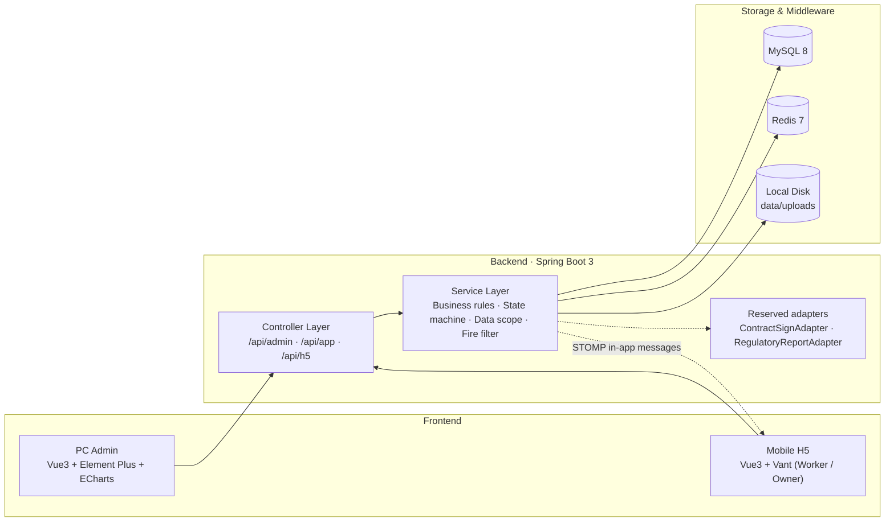
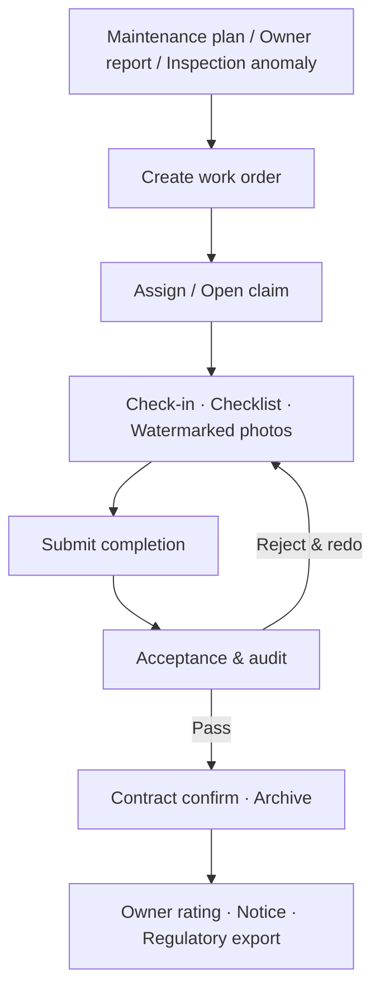

<div align="center">

# Property Work Order Management System

A lightweight facility & equipment work-order management platform for property companies

Elevators · Water & Drainage · Power Supply · HVAC · Security · Landscaping

[](https://spring.io/projects/spring-boot)
[](https://vuejs.org)
[](https://www.mysql.com)
[](https://redis.io)

**English · [简体中文](README.md)**

</div>

---

## Overview

Built around the "work order" as the smallest business unit, the platform ties plan & report triggering, dispatch & claiming, on-site evidence, acceptance & audit, responsibility tracing, and owner supervision into one complete loop:

**Plan / Report trigger → Dispatch / Claim → Check-in & photo evidence → Acceptance & audit → Responsibility tracing → Owner supervision**

It consists of three clients:

- **PC Admin** — for property and maintenance companies: ledgers, dispatch, audit, contracts, and dashboards
- **Mobile H5 Worker** — for maintenance, repair, and inspection staff: claim, execution, inspection, and performance
- **Mobile H5 Owner** — for owners: QR lookup, reporting, progress tracking, and notices

## Features

- **Full work-order lifecycle** — creation, dispatch, claiming, urging, acceptance, reject & redo, return for re-dispatch, cancellation, and archiving, with every state change traceable
- **Market-style dispatch** — multiple companies compete in the work-order hall, concurrency-safe claiming, automatic interception of off-duty / expired-certification personnel, single lead worker with assistants
- **Trusted on-site evidence** — location check-in (200 m radius), server-side watermarked photos, MD5 verification, equipment-type checklists, mandatory photo items blocking submission when missing
- **E-contracts & responsibility period** — auto-generated one-off contract on acceptance, dual-party in-platform confirmation, 45–60 day responsibility period, adjacent contracts forming a responsibility chain, PDF export
- **Maintenance plan engine** — scheduled and on-demand plans, 15-day elevator cycle, seasonal nodes, idempotent generation, overdue red-flag alerts
- **Inspection & rectification** — route-point sequences, frequency-based task generation, per-point check-in with readings, one-click anomaly-to-order conversion
- **Quality audit & credit** — acceptance completeness validation, reject deductions, owner satisfaction ratings, company & personnel credit records
- **Owner supervision** — scan to view public equipment info & maintenance records, three-step reporting, progress tracking, rating & complaints, notice board, with fire & private content permanently filtered
- **Dashboard & export center** — report trends, on-time rate, pass rate, rectification rate, warning lists; regulatory report, responsibility pack, inspection / profile / work-order export with audit logging

## Tech Stack

| Layer | Stack |
|:---|:---|
| Backend | Spring Boot 3.2 · MyBatis-Plus 3.5 · Sa-Token 1.37 (JDK 17+, UTF-8 by default) |
| Database / Cache | MySQL 8 · Redis 7 |
| Docs / Files | Knife4j · EasyExcel · openhtmltopdf · zxing · local disk storage (MinIO reserved) |
| Push | WebSocket STOMP (native) + in-app messages |
| PC Admin | Vue 3 · Vite 5 · TypeScript · Pinia · Element Plus · ECharts |
| Mobile H5 | Vue 3 · Vite 5 · TypeScript · Vant 4 |

## Architecture



## Core Flow



## Project Structure

```
├── backend/                     # Spring Boot single-module backend
│   ├── pom.xml
│   └── src/main/
│       ├── java/com/prop/wo/
│       │   ├── common/          # unified response / exceptions / annotations / interceptors / enums / utils / storage
│       │   ├── config/          # Sa-Token / Web / WebSocket / MyBatis / demo data initialization
│       │   └── modules/         # 13 business modules, layered entity / mapper / service / controller
│       │       ├── system/      # users & roles, dicts, params, audit logs, in-app messages
│       │       ├── basedata/    # 5-level estates, owners, teams & personnel, companies, Excel import/export
│       │       ├── equipment/   # one-device-one-file, QR codes, annual-check alerts & lockout
│       │       ├── checklist/   # checklist templates & mandatory-item validation
│       │       ├── workorder/   # work-order state machine, dispatch / claim / acceptance / settlement
│       │       ├── contract/    # e-contracts, responsibility period & chain, PDF (+ adapter)
│       │       ├── evidence/    # check-in, watermarked photos, on-site records
│       │       ├── plan/        # maintenance plan engine, seasonal nodes
│       │       ├── inspection/  # inspection routes, tasks, anomaly-to-order
│       │       ├── audit/       # acceptance records, credit ledger
│       │       ├── owner/       # public scan, reporting, rating, notices
│       │       ├── export/      # regulatory report, responsibility pack, export logs (+ adapter)
│       │       └── workbench/   # dashboard aggregation & warnings
│       └── resources/           # application.yml, fonts (Chinese fonts for PDF / watermark)
├── apps/
│   ├── web-admin/               # PC Admin (port 5173)
│   └── web-mobile/              # Mobile H5 dual-client (port 5174)
├── sql/
│   ├── init.sql                 # database + 50 tables + dicts & params
│   ├── data.sql                 # demo data
│   └── reset.ps1                # one-click database rebuild
├── data/uploads/                # runtime files (photos / contract PDF / exports / QR codes)
└── package.json / pnpm-workspace.yaml
```

## Quick Start

### Prerequisites

- JDK 17+ (21 recommended) · Maven 3.8+
- Node.js 18+ · pnpm 9 (`npm i -g pnpm`)
- MySQL 8.0 · Redis 7

### 1. Configure environment variables

Sensitive values such as database passwords are injected via environment variables, never hard-coded in the repository:

```bash
# Bash / Linux / macOS
export DB_PASSWORD=your-mysql-password
# Optional (defaults apply): DB_HOST / DB_PORT / DB_USERNAME / REDIS_HOST / REDIS_PORT
# Production must set: QR_SECRET=your-qr-signing-secret
```

```powershell
# PowerShell (Windows)
$env:DB_PASSWORD = "your-mysql-password"
$env:QR_SECRET   = "your-qr-signing-secret"
```

> See "Configuration" for the full list.

### 2. Initialize the database

```bash
mysql -uroot -p --default-character-set=utf8mb4 -e "source sql/init.sql"
mysql -uroot -p --default-character-set=utf8mb4 -e "source sql/data.sql"
```

> `init.sql` rebuilds the `prop_wo` database with 50 tables (drops existing data); `data.sql` is demo data — for production, run only `init.sql`.

### 3. Start the backend

```bash
cd backend
mvn clean package -DskipTests
java "-Dfile.encoding=UTF-8" -jar target/property-workorder.jar
```

> On PowerShell, `-Dfile.encoding=UTF-8` must be double-quoted; on JDK 21 you can run `java -jar target/property-workorder.jar` directly.

API docs: <http://localhost:8080/doc.html>

### 4. Start the frontends

```bash
pnpm install
pnpm dev:admin     # PC Admin  http://localhost:5173
pnpm dev:mobile    # Mobile H5 http://localhost:5174
```

Both projects proxy `/api` to backend `8080`.

### 5. Demo accounts

| Role | Account | Password | Entry |
|:---|:---|:---|:---|
| Administrator | `admin` | `admin123` | PC |
| Worker (elevator) | `worker` | `wk123` | H5 worker |
| Worker (water/electricity) | `worker2` | `wk123` | H5 worker |
| Worker (inspection) | `worker3` | `wk123` | H5 worker |
| Maintenance company admin | `company` | `cp123` | PC |
| Owner | `13800000001` | code `123456` | H5 owner |

> These are demo accounts for local demonstration only; change or remove them via "System → Users" in production.

## Configuration

Deployment-related config lives in `backend/src/main/resources/application.yml`; sensitive values can be overridden via environment variables:

| Environment variable | Default | Description |
|:---|:---|:---|
| `DB_HOST` / `DB_PORT` / `DB_USERNAME` | `127.0.0.1` / `3306` / `root` | MySQL connection |
| `DB_PASSWORD` | none (required) | MySQL password |
| `REDIS_HOST` / `REDIS_PORT` | `127.0.0.1` / `6379` | Redis connection |
| `QR_BASE_URL` | `http://localhost:5174/h5/equip` | QR code H5 URL prefix |
| `QR_SECRET` | `prop-wo-demo` | QR code HMAC signing key, must change in production |

Business parameters (`app.*`):

| Key | Description |
|:---|:---|
| `app.storage-root` | file storage root directory |
| `app.responsibility-default-days` | default responsibility period 45 days (45–60) |
| `app.checkin-radius-meter` | check-in radius, default 200 m |
| `app.checkin-skip-distance` | skip distance check in demo mode (set `false` in production) |
| `app.upload-max-size-mb` | max photo size, default 5 MB |
| `app.demo-init-photos` | auto-generate demo photos (set `false` in production) |
| `app.sms-fixed-code` | dev owner verification code; connect an SMS gateway in production |

## Production Deployment

### Build artifacts

```bash
pnpm build:admin     # output apps/web-admin/dist
pnpm build:mobile    # output apps/web-mobile/dist
mvn -f backend/pom.xml clean package -DskipTests   # output backend/target/*.jar
```

### Nginx example

```nginx
server {
    listen 80;
    server_name property.example.com;

    root /opt/property/apps/web-admin/dist;
    index index.html;

    location /api/ {
        proxy_pass http://127.0.0.1:8080;
        proxy_set_header Host $host;
        proxy_set_header X-Real-IP $remote_addr;
        client_max_body_size 20m;
    }

    location /ws {
        proxy_pass http://127.0.0.1:8080;
        proxy_http_version 1.1;
        proxy_set_header Upgrade $http_upgrade;
        proxy_set_header Connection "upgrade";
    }

    location / { try_files $uri $uri/ /index.html; }          # PC (hash routing)
    location /h5/ {
        alias /opt/property/apps/web-mobile/dist/;
        try_files $uri $uri/ /h5/index.html;                  # H5 (history routing, needs fallback)
    }
}
```

> H5 uses history routing, so `/h5/equip/{code}` must fall back to the H5 `index.html`, and set `QR_BASE_URL` to `https://property.example.com/h5/equip`. Camera and location capabilities depend on an HTTPS secure context.

### Scheduled tasks

| Task | Time | Description |
|:---|:---|:---|
| Annual check scan | daily 00:05 | 30 / 15 / 7-day tiered reminders, auto lockout when overdue |
| Maintenance overdue scan | daily 00:30 | flag elevator red when 15 days without maintenance |
| Plan generation scan | daily 00:10 | generate pending orders when the advance-generation day arrives (idempotent) |
| Seasonal node scan | daily 00:20 | generate maintenance orders by facility type on matched month/day |
| Inspection task generation | daily 00:40 | generate tasks by daily / weekly / monthly frequency |
| Contract expiry scan | daily 01:15 | remind both parties 7 days before expiry, mark expired |
| Timeout urging | every 10 min | send in-app messages for orders not claimed / finished in time |

### Backup script (example)

```bash
#!/usr/bin/env bash
set -euo pipefail
DATE=$(date +%Y%m%d_%H%M)
BACKUP_DIR=/opt/property/backup
mkdir -p "$BACKUP_DIR"
mysqldump -uroot -p"$DB_PASSWORD" --single-transaction --routines prop_wo | gzip > "$BACKUP_DIR/prop_wo_$DATE.sql.gz"
tar -czf "$BACKUP_DIR/uploads_$DATE.tar.gz" -C /opt/property/data uploads
find "$BACKUP_DIR" -type f -mtime +30 -delete
```

> Back up evidence images (original + watermarked + MD5) and the database daily, retaining 30 days.

### Production checklist

- [ ] Set database / Redis passwords and `QR_SECRET` via environment variables
- [ ] `app.demo-init-photos=false`, `app.checkin-skip-distance=false`, remove demo data and rebuild the production database
- [ ] Integrate an SMS gateway (replace the fixed-code implementation in `OwnerService.sendCode`)
- [ ] Enable HTTPS (camera, location and other browser capabilities depend on a secure context)
- [ ] Nginx `client_max_body_size` ≥ 20m
- [ ] Run scheduled tasks in a single instance; use a distributed lock for urging tasks in multi-instance deployment
- [ ] Include the file directory in backups and set disk alerts

## Database

50 business tables grouped by module (all include `id / create_by / create_time / update_by / update_time / is_deleted`, logical delete, no physical foreign keys):

| Group | Tables |
|:---|:---|
| System | `sys_user` / `sys_dict` / `sys_dict_item` / `sys_config` / `sys_log_login` / `sys_log_oper` / `sys_message` |
| Profiles | `community` / `building` / `unit` / `house` / `house_owner` / `owner_user` / `company` / `company_qualification` / `team` / `personnel` |
| Equipment | `equipment` / `equipment_ext` / `equipment_qr` / `annual_check` / `equipment_status_log` |
| Checklist | `checklist_template` / `checklist_item` / `work_order_checklist` |
| Work order | `work_order` / `work_order_log` / `work_order_claim` / `work_order_assign` / `work_order_settlement` |
| Contract | `contract` / `contract_confirm` / `responsibility_link` |
| Evidence | `evidence_checkin` / `evidence_photo` / `evidence_record` |
| Plan | `maintenance_plan` / `plan_device_rel` / `seasonal_node` / `plan_generate_log` |
| Inspection | `inspection_route` / `inspection_point` / `inspection_check_item` / `inspection_task` / `inspection_task_point` / `inspection_record` |
| Audit / Owner / Export | `acceptance_record` / `credit_record` / `publish_notice` / `export_log` |

## FAQ

| Symptom | Resolution |
|:---|:---|
| Startup error `Could not resolve placeholder 'DB_PASSWORD'` | Environment variable not set; run `export DB_PASSWORD=...` first |
| Startup error `Communications link failure` | Check MySQL is running, credentials, and that the `prop_wo` database exists |
| Login reports Redis connection failure | Check the Redis service and `REDIS_HOST` / `REDIS_PORT` |
| PDF shows boxes instead of Chinese | Ensure `backend/src/main/resources/fonts/PropWoSans.ttf` is packaged in the jar |
| Image / PDF preview returns 401 | Use `/api/file/view?path=...&token=...` with the token |
| Check-in reports "too far away" | Equipment must have coordinates registered; for demo, set `app.checkin-skip-distance=true` |

---

## License

This project is for learning and demonstration only. Data is fictional demo data and contains no real personal information.

## Disclaimer

Fire-protection equipment is isolated for compliance only (permanently filtered in the owner client and notices) and has no fire-business pages. E-contracts are dual-party in-platform confirmation + timestamps, not connected to a third-party CA. Regulatory reporting exports Excel by field for manual submission, with a reserved `RegulatoryReportAdapter` layer (phase 2: integrate with the regulatory platform).
