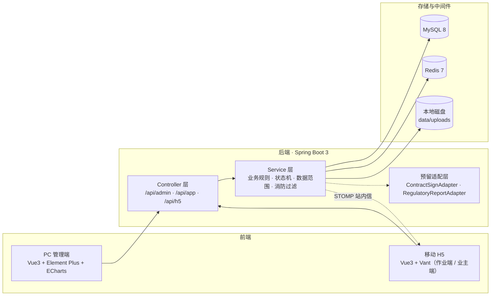
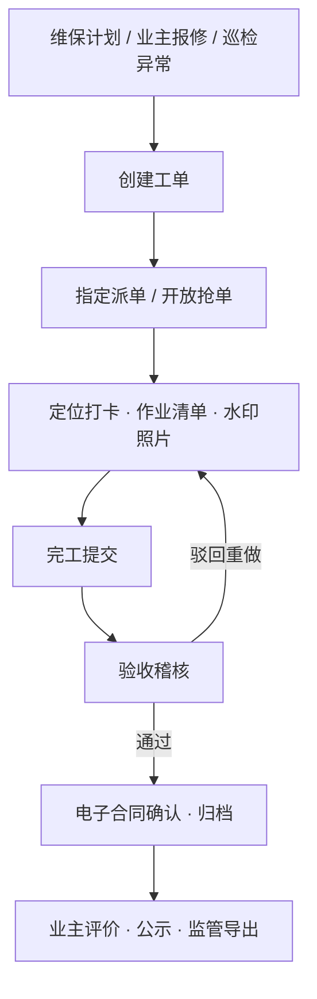

<div align="center">

# 物业公司运维工单管理系统

面向物业公司的轻量级设施设备运维工单管理平台

电梯 · 给排水 · 供配电 · 暖通空调 · 安防监控 · 园林绿化

[](https://spring.io/projects/spring-boot)
[](https://vuejs.org)
[](https://www.mysql.com)
[](https://redis.io)

**[English](README.en.md) · 简体中文**

</div>

---

## 项目简介

以「工单」为最小业务单元，将计划与报修触发、派单抢单、现场留痕、验收稽核、责任追溯与业主监督串成一条完整闭环：

**计划 / 报修触发 → 派单 / 抢单 → 打卡与拍照留痕 → 验收稽核 → 责任周期追溯 → 业主公开监督**

系统由三端构成：

- **PC 管理端** — 面向物业与维保公司，承载台账、派单、稽核、合同与看板
- **移动 H5 作业端** — 面向维保、维修与巡检人员，承载接单、执行、巡检与业绩
- **移动 H5 业主端** — 面向业主，承载扫码查询、报修、进度跟踪与公示

## 核心特性

- **工单全生命周期** — 建单、派单、抢单、催办、验收、驳回重做、退回重派、作废、归档，状态变更全程留痕
- **市场化派单** — 工单大厅多家公司竞争接单，抢单并发互斥，离岗与资质过期人员自动拦截，单主责人配协助人员
- **现场留痕可信链** — 定位打卡（200 米判定）、服务端水印照片、MD5 校验、分设备类型作业清单，强制拍照项缺失禁止提交
- **电子合同与责任周期** — 接单自动生成单次合同、双方平台内确认、责任周期 45–60 天、同设备相邻合同形成责任链、PDF 导出
- **维保计划引擎** — 定期与按需计划、电梯 15 天周期、季节保养节点、幂等生成、逾期红牌告警
- **巡检与整改** — 路线点位序列、按频次生成任务、逐点打卡与读数、异常一键转报修工单
- **质量稽核与信用** — 验收完整性校验、驳回扣分、业主满意度评价、公司与人员信用记录
- **业主公开监督** — 扫码即看设备公开信息与维保记录、三步报修、进度跟踪、评价投诉、公示栏，消防与隐私内容永久过滤
- **看板与导出中心** — 报修趋势、及时率、合格率、整改率、预警清单；监管报表、责任记录包、巡检 / 档案 / 工单导出并留痕

## 技术栈

| 层 | 选型 |
|:---|:---|
| 后端 | Spring Boot 3.2 · MyBatis-Plus 3.5 · Sa-Token 1.37（JDK 17+，默认 UTF-8） |
| 数据库 / 缓存 | MySQL 8 · Redis 7 |
| 文档 / 文件 | Knife4j · EasyExcel · openhtmltopdf · zxing · 本地磁盘存储（预留 MinIO） |
| 推送 | WebSocket STOMP（原生）+ 站内信兜底 |
| PC 管理端 | Vue 3 · Vite 5 · TypeScript · Pinia · Element Plus · ECharts |
| 移动 H5 | Vue 3 · Vite 5 · TypeScript · Vant 4 |

## 系统架构



## 核心流程



## 项目结构

```
├── backend/                     # Spring Boot 单模块后端
│   ├── pom.xml
│   └── src/main/
│       ├── java/com/prop/wo/
│       │   ├── common/          # 统一响应 / 异常 / 注解 / 拦截器 / 枚举 / 工具 / 存储
│       │   ├── config/          # Sa-Token / Web / WebSocket / MyBatis / 演示数据初始化
│       │   └── modules/         # 13 个业务模块，分层 entity / mapper / service / controller
│       │       ├── system/      # 用户角色、字典、参数、审计日志、站内信
│       │       ├── basedata/    # 五级楼盘、业主、班组人员、维保公司、Excel 导入导出
│       │       ├── equipment/   # 设备一物一档、二维码、年检预警与锁停
│       │       ├── checklist/   # 作业清单模板与强制项校验
│       │       ├── workorder/   # 工单状态机、派单 / 抢单 / 验收 / 结算
│       │       ├── contract/    # 电子合同、责任周期、责任链、PDF（+ adapter）
│       │       ├── evidence/    # 打卡、水印照片、现场记录
│       │       ├── plan/        # 维保计划引擎、季节节点
│       │       ├── inspection/  # 巡检路线、任务、异常转工单
│       │       ├── audit/       # 验收记录、信用台账
│       │       ├── owner/       # 业主公开扫码、报修、评价、公示
│       │       ├── export/      # 监管报表、责任记录包、导出留痕（+ adapter）
│       │       └── workbench/   # 数据看板聚合与预警
│       └── resources/           # application.yml、fonts（PDF / 水印中文字体）
├── apps/
│   ├── web-admin/               # PC 管理端（端口 5173）
│   └── web-mobile/              # 移动 H5 双端（端口 5174）
├── sql/
│   ├── init.sql                 # 建库 + 50 张表 + 字典与参数
│   ├── data.sql                 # 演示数据
│   └── reset.ps1                # 一键重建数据库
├── data/uploads/                # 运行期文件（照片 / 合同 PDF / 导出 / 二维码）
└── package.json / pnpm-workspace.yaml
```

## 快速开始

### 环境要求

- JDK 17+（推荐 21）· Maven 3.8+
- Node.js 18+ · pnpm 9（`npm i -g pnpm`）
- MySQL 8.0 · Redis 7

### 1. 配置环境变量

数据库密码等敏感项通过环境变量注入，不在仓库中硬编码：

```bash
# Bash / Linux / macOS
export DB_PASSWORD=你的MySQL密码
# 可选（有默认值）：DB_HOST / DB_PORT / DB_USERNAME / REDIS_HOST / REDIS_PORT
# 生产环境务必设置：QR_SECRET=你的二维码签名密钥
```

```powershell
# PowerShell（Windows）
$env:DB_PASSWORD = "你的MySQL密码"
$env:QR_SECRET   = "你的二维码签名密钥"
```

> 完整配置项见「配置说明」。

### 2. 初始化数据库

```bash
mysql -uroot -p --default-character-set=utf8mb4 -e "source sql/init.sql"
mysql -uroot -p --default-character-set=utf8mb4 -e "source sql/data.sql"
```

> `init.sql` 会重建 `prop_wo` 库与 50 张表（清空现有数据）；`data.sql` 为演示数据，正式上线仅执行 `init.sql`。

### 3. 启动后端

```bash
cd backend
mvn clean package -DskipTests
java "-Dfile.encoding=UTF-8" -jar target/property-workorder.jar
```

> PowerShell 下 `-Dfile.encoding=UTF-8` 需加双引号；JDK 21 可直接 `java -jar target/property-workorder.jar`。

接口文档：<http://localhost:8080/doc.html>

### 4. 启动前端

```bash
pnpm install
pnpm dev:admin     # PC 管理端  http://localhost:5173
pnpm dev:mobile    # 移动 H5    http://localhost:5174
```

两个工程均已配置 `/api` 代理到后端 `8080`。

### 5. 演示账号

| 角色 | 账号 | 密码 | 入口 |
|:---|:---|:---|:---|
| 管理员 | `admin` | `admin123` | PC |
| 作业人员（电梯） | `worker` | `wk123` | H5 作业端 |
| 作业人员（水电） | `worker2` | `wk123` | H5 作业端 |
| 作业人员（巡检） | `worker3` | `wk123` | H5 作业端 |
| 维保公司管理员 | `company` | `cp123` | PC |
| 业主 | `13800000001` | 验证码 `123456` | H5 业主端 |

> 以上为演示账号，仅用于本地演示；生产环境请通过「系统管理 → 用户」修改或删除。

## 配置说明

部署相关配置集中在 `backend/src/main/resources/application.yml`，敏感项支持环境变量覆盖：

| 环境变量 | 默认值 | 说明 |
|:---|:---|:---|
| `DB_HOST` / `DB_PORT` / `DB_USERNAME` | `127.0.0.1` / `3306` / `root` | MySQL 连接 |
| `DB_PASSWORD` | 无（必填） | MySQL 密码 |
| `REDIS_HOST` / `REDIS_PORT` | `127.0.0.1` / `6379` | Redis 连接 |
| `QR_BASE_URL` | `http://localhost:5174/h5/equip` | 二维码 H5 访问前缀 |
| `QR_SECRET` | `prop-wo-demo` | 二维码 HMAC 签名密钥，生产必须更换 |

业务参数（`app.*`）：

| 键 | 说明 |
|:---|:---|
| `app.storage-root` | 文件存储根目录 |
| `app.responsibility-default-days` | 责任周期默认 45 天（45–60） |
| `app.checkin-radius-meter` | 定位打卡半径，默认 200 米 |
| `app.checkin-skip-distance` | 演示模式跳过定位距离校验（生产置 `false`） |
| `app.upload-max-size-mb` | 单张照片上限，默认 5MB |
| `app.demo-init-photos` | 是否自动生成演示照片（生产置 `false`） |
| `app.sms-fixed-code` | 开发环境业主验证码，生产需接短信网关 |

## 生产部署

### 构建产物

```bash
pnpm build:admin     # 产物 apps/web-admin/dist
pnpm build:mobile    # 产物 apps/web-mobile/dist
mvn -f backend/pom.xml clean package -DskipTests   # 产物 backend/target/*.jar
```

### Nginx 示例

```nginx
server {
    listen 80;
    server_name property.example.com;

    root /opt/property/apps/web-admin/dist;
    index index.html;

    location /api/ {
        proxy_pass http://127.0.0.1:8080;
        proxy_set_header Host $host;
        proxy_set_header X-Real-IP $remote_addr;
        client_max_body_size 20m;
    }

    location /ws {
        proxy_pass http://127.0.0.1:8080;
        proxy_http_version 1.1;
        proxy_set_header Upgrade $http_upgrade;
        proxy_set_header Connection "upgrade";
    }

    location / { try_files $uri $uri/ /index.html; }          # PC（hash 路由）
    location /h5/ {
        alias /opt/property/apps/web-mobile/dist/;
        try_files $uri $uri/ /h5/index.html;                  # H5（history 路由，需 fallback）
    }
}
```

> H5 使用 history 路由，`/h5/equip/{code}` 必须 fallback 到 H5 的 `index.html`，并将 `QR_BASE_URL` 改为 `https://property.example.com/h5/equip`。相机与定位能力依赖 HTTPS 安全上下文。

### 定时任务

| 任务 | 时间 | 说明 |
|:---|:---|:---|
| 年检预警扫描 | 每日 00:05 | 30 / 15 / 7 天分级提醒，超期自动锁停 |
| 维保逾期扫描 | 每日 00:30 | 电梯 15 天未维保标记红牌 |
| 计划生成扫描 | 每日 00:10 | 到达提前生成日生成待派工单（幂等） |
| 季节节点扫描 | 每日 00:20 | 命中月日按设施类型生成保养工单 |
| 巡检任务生成 | 每日 00:40 | 按日 / 周 / 月频次生成任务 |
| 合同到期扫描 | 每日 01:15 | 届满前 7 天提醒，届满置已到期 |
| 超时催办 | 每 10 分钟 | 超时未接单 / 未完成发送站内信 |

### 备份脚本（示例）

```bash
#!/usr/bin/env bash
set -euo pipefail
DATE=$(date +%Y%m%d_%H%M)
BACKUP_DIR=/opt/property/backup
mkdir -p "$BACKUP_DIR"
mysqldump -uroot -p"$DB_PASSWORD" --single-transaction --routines prop_wo | gzip > "$BACKUP_DIR/prop_wo_$DATE.sql.gz"
tar -czf "$BACKUP_DIR/uploads_$DATE.tar.gz" -C /opt/property/data uploads
find "$BACKUP_DIR" -type f -mtime +30 -delete
```

> 留痕影像（原图 + 水印图 + MD5）与数据库每日备份，保留 30 天。

### 上线检查清单

- [ ] 通过环境变量设置数据库 / Redis 密码与 `QR_SECRET`
- [ ] `app.demo-init-photos=false`、`app.checkin-skip-distance=false`，清理演示数据重建正式库
- [ ] 接入短信网关（替换 `OwnerService.sendCode` 的固定验证码实现）
- [ ] 配置 HTTPS（相机、定位等浏览器能力依赖安全上下文）
- [ ] Nginx `client_max_body_size` ≥ 20m
- [ ] 定时任务单实例运行；多实例部署时催办任务需改用分布式锁
- [ ] 文件目录纳入备份并限制磁盘告警

## 数据库

共 50 张业务表，按模块分组（均含 `id / create_by / create_time / update_by / update_time / is_deleted`，逻辑删除，无物理外键）：

| 分组 | 表 |
|:---|:---|
| 系统 | `sys_user` / `sys_dict` / `sys_dict_item` / `sys_config` / `sys_log_login` / `sys_log_oper` / `sys_message` |
| 档案 | `community` / `building` / `unit` / `house` / `house_owner` / `owner_user` / `company` / `company_qualification` / `team` / `personnel` |
| 设备 | `equipment` / `equipment_ext` / `equipment_qr` / `annual_check` / `equipment_status_log` |
| 清单 | `checklist_template` / `checklist_item` / `work_order_checklist` |
| 工单 | `work_order` / `work_order_log` / `work_order_claim` / `work_order_assign` / `work_order_settlement` |
| 合同 | `contract` / `contract_confirm` / `responsibility_link` |
| 留痕 | `evidence_checkin` / `evidence_photo` / `evidence_record` |
| 计划 | `maintenance_plan` / `plan_device_rel` / `seasonal_node` / `plan_generate_log` |
| 巡检 | `inspection_route` / `inspection_point` / `inspection_check_item` / `inspection_task` / `inspection_task_point` / `inspection_record` |
| 稽核 / 业主 / 导出 | `acceptance_record` / `credit_record` / `publish_notice` / `export_log` |

## 常见问题

| 现象 | 处理 |
|:---|:---|
| 启动报 `Could not resolve placeholder 'DB_PASSWORD'` | 未设置环境变量，先 `export DB_PASSWORD=...` |
| 启动报 `Communications link failure` | 检查 MySQL 是否运行、账号密码、`prop_wo` 库是否存在 |
| 登录报 Redis 连接失败 | 检查 Redis 服务与 `REDIS_HOST` / `REDIS_PORT` |
| PDF 中文变方块 | 确认 `backend/src/main/resources/fonts/PropWoSans.ttf` 随 jar 打包 |
| 图片 / PDF 预览 401 | 使用 `/api/file/view?path=...&token=...` 携带令牌 |
| 定位打卡提示距离过远 | 设备需登记坐标；演示可置 `app.checkin-skip-distance=true` |

---

## 许可证

本项目仅供学习与演示，数据为虚构演示数据，不含真实个人信息。

## 免责声明

消防类设备仅做合规隔离（业主端与公示永久过滤），不做消防业务页面；电子合同为平台内双方确认 + 时间戳，未接第三方 CA；监管报送为按字段导出 Excel 人工报送，预留 `RegulatoryReportAdapter` 适配层（二期对接监管平台）。
